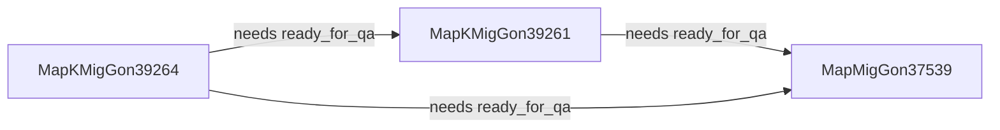

<!-- GENERATED by tools/context.mjs index. Do not edit; edit the nodes and rebuild. -->
# Context index

Start here: [project.md](project.md) (what this is), [glossary.md](glossary.md) (terms and banned words).
Search: `node tools/context.mjs find <words>`. One story with its neighbors: `node tools/context.mjs slice <id>`. What blocks a story: `node tools/context.mjs deps <story id>`.

Nodes: 17 (table 4, agent 2, automation 2, interface 1, source 1, story 3, epic 1, decision 1, note 0).

## epic

| id | status | summary |
|---|---|---|
| [epic:soc2-evidence](epics/soc2-evidence.md) | open | Key Project that makes agent and automation activity produce audit-ready evidence, organized by SOC 2 control, for Scrut. Release v1. |

## story

| id | status | summary |
|---|---|---|
| [story:MapKMigGon39261](stories/MapKMigGon39261.md) | planned | Run logs and adapters so Loom, Ingestion Agent, automations and ticket reviews produce evidence through triggered capture plus an hourly safety net. |
| [story:MapKMigGon39264](stories/MapKMigGon39264.md) | planned | Airtable-only control mapping, per-control interface and CSV export of confirmed evidence. No scripts or automations. |
| [story:MapMigGon37539](stories/MapMigGon37539.md) | existing | Original story. Evidence table, evidence module, approvals capture and run-status logging. Split into P01 (39261) and P02 (39264). |

## table

| id | status | summary |
|---|---|---|
| [table:activity_runs](data/tables/activity_runs.md) | planned | New append-only run log for the Ingestion Agent, qualifying automations and the ticket review flow, one row per finished run. |
| [table:evidence](data/tables/evidence.md) | planned | One record per qualifying run or approval, created once by the evidence module and traceable to its source row. |
| [table:loom_sync_runs](data/tables/loom_sync_runs.md) | existing | Existing run log written only by Loom, one row per sync run with status, trigger, timestamps and counts. |
| [table:soc2_control_mappings](data/tables/soc2_control_mappings.md) | planned | One row per evidence source type with its SOC 2 controls and a provisional flag; the table evidence.source_type links to. |

## agent

| id | status | summary |
|---|---|---|
| [agent:ingestion-agent](data/agents/ingestion-agent.md) | existing | Hyperagent agent triggered from Slack that ingests content into Map King Hub; will log each finished run to activity_runs. |
| [agent:loom](data/agents/loom.md) | existing | Hyperagent agent that syncs work sources into Map King Hub; runs each morning and on demand from the panel or Slack. |

## automation

| id | status | summary |
|---|---|---|
| [automation:evidence-module](data/automations/evidence-module.md) | planned | Shared module that validates, normalizes and writes evidence records and confirms the write; used by every entry automation. |
| [automation:evidence-run-capture](data/automations/evidence-run-capture.md) | planned | Record-triggered automation on terminal run rows plus an hourly safety net, with one adapter per source type. |

## interface

| id | status | summary |
|---|---|---|
| [interface:per-control-evidence](data/interfaces/per-control-evidence.md) | planned | Airtable interface list of confirmed evidence filtered by SOC 2 control, with CSV download of the export columns only. |

## source

| id | status | summary |
|---|---|---|
| [source:map-king-hub](data/sources/map-king-hub.md) | existing | The Airtable base appcdpGNTo0DouoqJ that holds all tables, automations and interfaces for Map King. |

## decision

| id | status | summary |
|---|---|---|
| [decision:2026-10-14-points-and-sprint-order](decisions/2026-10-14-points-and-sprint-order.md) | open | Open for the PM: total is 15 SP not 13 (4 is off the Fibonacci scale), and 39261 and 39264 sit in sprint 4 while their prerequisite 37539 sits in sprint 5. |

## Story dependencies

