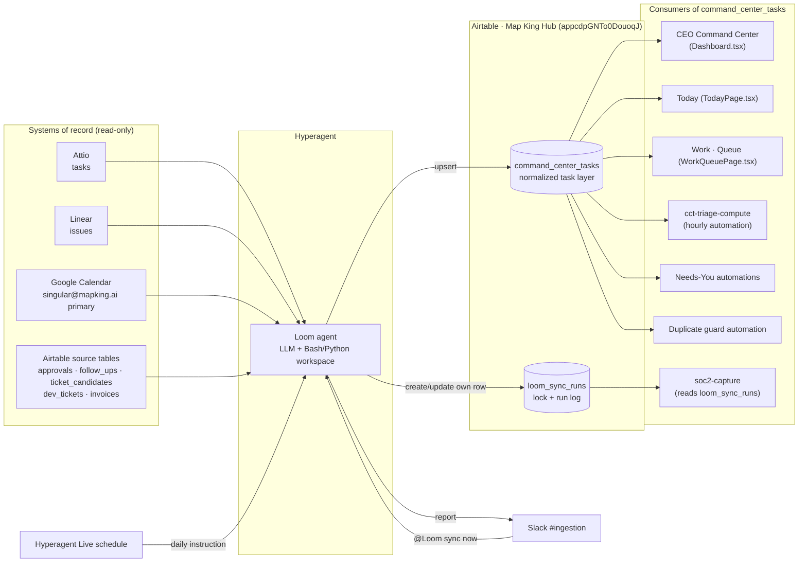
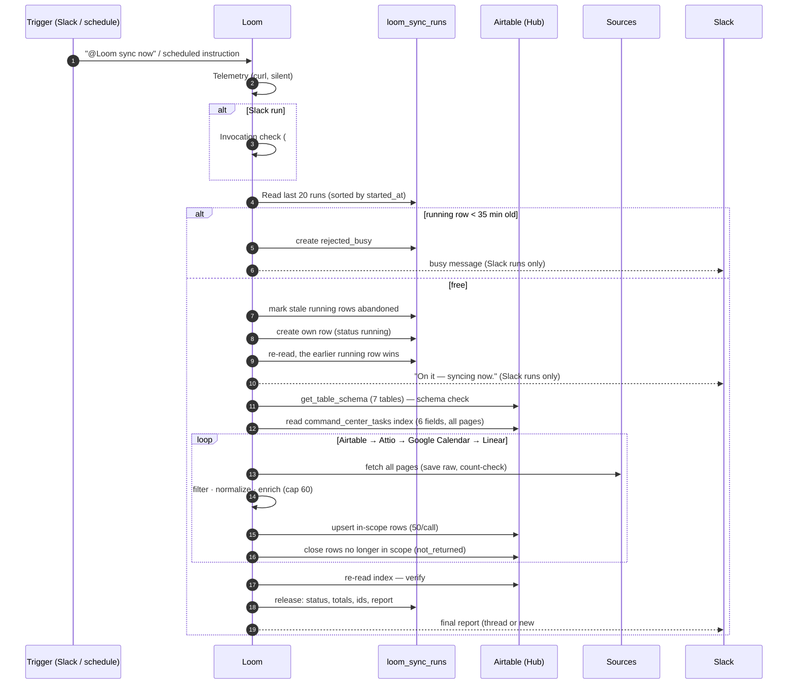
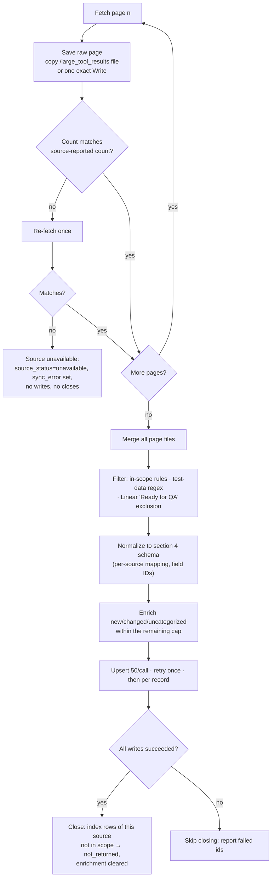
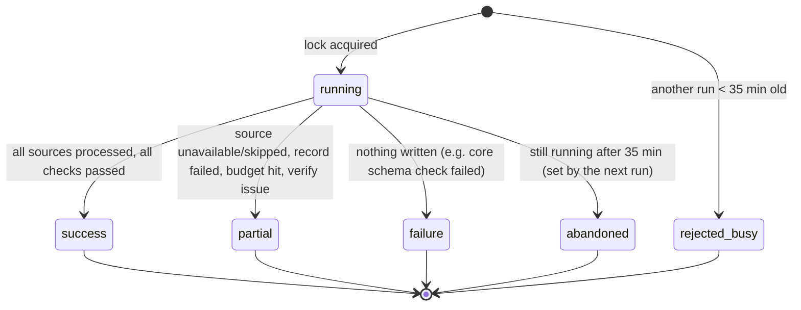
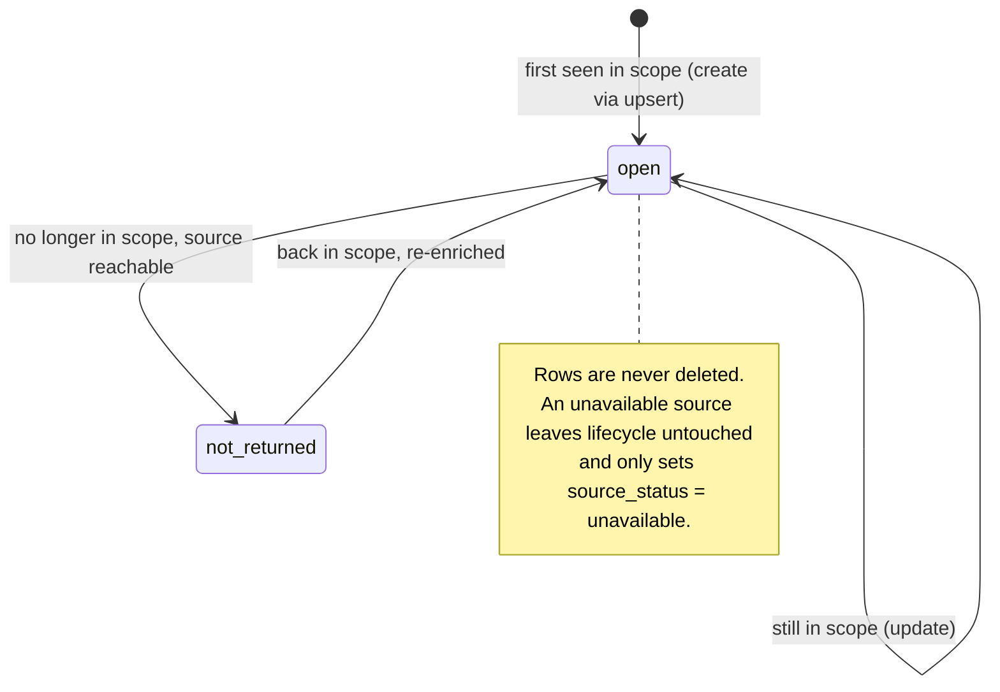

# Loom — Technical Documentation

Agent: Loom (Hyperagent `cmu1q1bq7009p07adrlnq0ff6`) · Prompt: v3.9.1 · Story: MapKMigGon38532 (CC1) · Updated: 2026-10-15

Loom is the ingestion and normalization layer of the Map King Command Center. It is a Hyperagent agent whose entire behavior is defined by a system prompt (`loom.agent.md`) and executed by an LLM that calls MCP integrations and runs Python in a sandboxed workspace. This document describes the architecture, the execution model, the data contract, the failure semantics and the known limitations, as of prompt v3.9.1.

| File | Role |
|---|---|
| `loom.agent.md` | System prompt. Source of truth for behavior. Front matter is metadata; the prompt starts at `## Telemetry` |
| `loom.changelog.md` | Version history, one entry per prompt version, each tied to an observed run |
| `../../loom-execution-config.md` | Operational configuration: Hyperagent settings, Slack, schedule, runbook |
| `bkg/loom.agent.v1.original.md` | Original v1 prompt, kept for reference |

---

## 1. System context

Loom reads four systems of record, writes one normalized table, and every Command Center surface reads only that table. It never writes back to a source.

Design principles, all enforced by the prompt:

- **Single writer of normalized fields.** Loom is the only writer of the 22 fields listed in prompt section 3b. Other components own other fields of the same table (section 4 of this document).
- **Read-only against sources.** No source system is ever modified; user decisions (lanes, triage, overrides) live in separate tables.
- **Idempotent writes.** Every task write is an upsert keyed by `normalized_task_id`.
- **Never delete.** Tasks that leave scope are closed (`lifecycle = not_returned`), never removed.
- **Degrade per source.** One unavailable source never blocks the others.

---

## 2. Runtime and deployment

| Aspect | Value |
|---|---|
| Platform | Hyperagent agent, model profile Balanced, effort medium |
| Turn limit | 30 min (`turnTimeoutMinutes`); the run is killed with no report. The prompt budgets 20 min |
| Integrations | `airtable`, `attio`, `linear`, `googlecalendar`, `slack` |
| Workspace | `/agent/workspace/`, empty at the start of every run (no state survives between runs) |
| Large tool results | Written by the platform to `/large_tool_results/<call>`; small results are returned inline to the model |
| Triggers | Slack mention in `#ingestion`; Hyperagent Live schedule (daily, fires at the time of day it was enabled) |
| Subagents | Forbidden |
| Memory / auto-save | Off |
| Deployment | The prompt is pasted into Hyperagent from the first line after the front matter, then verified by exporting the agent |

Hyperagent's prompt editor stores markdown escaped (`\_`, `&lt;`, auto-links) and has mangled fenced code blocks on paste. The prompt is therefore written without fenced blocks and without tables; executable snippets are single-line inline code, which survives intact.

### Tool surface

| Purpose | Action | Notes |
|---|---|---|
| Read any Airtable table | `airtable__list_records_for_table` | `fieldIds` by ID only; `pageSize` 1000; `cursor`/`nextCursor` |
| Write tasks | `airtable__update_records_for_table` | `performUpsert` on `fldmSHhnTbC1Go3Dw`, 50 records per call, `paramsFile` |
| Write run log | `airtable__create_records_for_table`, `airtable__update_records_for_table` | Only on `loom_sync_runs`, only its own row |
| Schema check | `airtable__get_table_schema` | Once per run; returns IDs and types, not names |
| Attio | `attio__list-tasks` | `limit` 10, `offset` paging (contract values from the prompt) |
| Linear | `linear__list_issues`, `linear__get_issue` | Full list paged (`limit` 250), filtered in script; `get_issue` for full descriptions |
| Google Calendar | `GoogleCalendarFindEvents` | `primary`, 14-day window, recurring events expanded to instances |
| Slack | Final reply relay (Slack runs), `SlackBotSendMessage` (scheduled runs) | `#ingestion` = `C0BRF6AHDJQ` |
| Telemetry | `curl` to `singular-skill-tracker` | Fire-and-forget |
| Processing | Bash / Python, `Write` | All filtering, mapping and diffing run in scripts |

---

## 3. Execution model

### 3.1 Run sequence

### 3.2 Per-source pipeline

### 3.3 Run state machine (`loom_sync_runs.status`)

### 3.4 Task lifecycle (`command_center_tasks.lifecycle`)

`closed` exists in the field's options but is not produced by v3.9.1; all exits from scope use `not_returned`.

### 3.5 Time budget

| Phase | Observed (Oct 2026) | Dominant cost |
|---|---|---|
| Lock, schema, index | < 1 min | Index of ~870 rows in one page |
| Airtable sources | < 1 min | 5 small tables |
| Attio | 1–2 min | `limit` 10 → ~4 calls per 36 tasks |
| Google Calendar | < 1 min | 1 call |
| Linear | 2–5 min | ~1,100 issues paged at 250, ~900 discarded in script; `get_issue` per changed truncated description |
| Enrichment | variable | LLM work, capped at 60 tasks |
| Total | 5–10 min | Budget 20 min, hard kill 30 min |

---

## 4. Data contract

### 4.1 `command_center_tasks` — field ownership

| Owner | Fields |
|---|---|
| Loom (prompt section 3b) | `normalized_task_id`, `source`, `source_record_id`, `source_table`, `source_url`, `title`, `description`, `owner`, `due_date`, `status_raw`, `domain_tag`, `lifecycle`, `last_updated_at`, `synced_at`, `source_status`, `sync_error`, `category`, `tags`, `schedulable`, `starts_at`, `ends_at`, `all_day` |
| Reserved for Loom v3.10 | `source_labels` |
| MapKMigGon38570 (Needs-You) | `needs_you_manual_any` (rollup), `needs_you_signals` (formula), `waiting_since`, `waiting_since_basis` |
| Airtable | `created_at` (created time) |
| Links (written from the other side) | `fire_ranks`, `priority_events`, `power_hour_items`, `triage` |

Key: `normalized_task_id` = `attio:<task id>` · `linear:<issue key>` · `gcal:<event instance id>` · `airtable:<table>:<record id>`.

### 4.2 Source mapping

| Target | Attio | Linear | Google Calendar | Airtable |
|---|---|---|---|---|
| `domain_tag` | Sales | Product | Ops | per table (below) |
| In scope | `is_completed` false | statusType triage/backlog/unstarted/started, status ≠ "Ready for QA" | confirmed, not ended, today → +14 d | per table (below) |
| `title` | content | title | summary | per table |
| `description` | content | description (full via `get_issue`, ≤ 2,000) | description (≤ 2,000) | per table |
| `owner` | — | assignee | organizer email | per table |
| `due_date` | deadline | dueDate | start date (Montevideo) | per table |
| `last_updated_at` | `created_at` | updatedAt | updated | per table |
| Extra | — | — | `starts_at`, `ends_at` (UTC), `all_day` | — |

| Airtable table | `domain_tag` | In scope | title / description | owner | due_date | status_raw | last_updated_at |
|---|---|---|---|---|---|---|---|
| `approvals` | Ops | approval_status = Pending | name / context_notes | approved_by | empty | approval_status | last_modified → created |
| `follow_ups` | Sales | days_since_last_contact ≥ 3 and approval_status empty or Draft | name / draft_content_ai | approved_by | empty | approval_status | last_modified → created |
| `ticket_candidates` | QA | review_status = pending | finding_title / finding_summary | reviewed_by | empty | review_status | created_at |
| `dev_tickets` | QA | status = New or Needs Max Input | title / description | empty | empty | status | record createdTime |
| `invoices` | Revenue | due_date < today and approval_status ≠ Paid | name / invoice_notes | approved_by | due_date | approval_status | last_modified → created |

Test data (all sources, never written): title matches `^\s*(\[test\]|test(\s*\d+)?\s*[-—–:])|dummy|\(demo\)` (case-insensitive).

### 4.3 Enrichment

AI-assigned on new, changed (by `last_updated_at`) or uncategorized in-scope tasks; capped at 60 per run (150 in rebuild), spent in processing order. `category` ∈ {Sales, Delivery, Product, QA, Revenue, Ops, Uncategorized}; `tags` ⊆ a fixed list of 10, max 3; `schedulable` boolean with an explicit decision rule. Closing a task clears all three, which forces re-enrichment if it reopens.

### 4.4 `loom_sync_runs`

One row per run, written only by Loom: `run_id` (`loom-YYYYMMDD-HHMMSS` UTC), `status`, `mode`, `trigger`, `started_at`, `finished_at`, totals, `source_counts`, `failed_ids`, `fallback_ids`, `report` (verbatim). The table doubles as an advisory lock. `last_modified` (SOC 2) is not written by Loom.

---

## 5. Guarantees and invariants

| Invariant | Mechanism |
|---|---|
| No duplicate task rows | Upsert on `normalized_task_id`; verify step counts duplicates; Airtable duplicate-guard automation as backstop |
| No writes to sources | Prompt guardrails; Loom has no write actions mapped for sources |
| No unverified data written | Raw-page rule and count check (prompt section 2) |
| No field written by guess | Field-ID map and schema check (prompt section 3b) |
| Partial runs stay consistent | Source-by-source processing; closing only after all of a source's writes succeed; unavailable sources keep their rows |
| At most one sync at a time | Lock row + re-read tie-break; 35-min abandonment |
| Every run is traceable | Run row with totals, failed ids and verbatim report; report names the prompt version |

---

## 6. Failure modes

| Failure | Detection | Handling | Report |
|---|---|---|---|
| Source API error / unauthorized / timeout | Tool error | Source unavailable; rows marked `unavailable`, lifecycle untouched | ⚠️, status on source line |
| Page count mismatch | Count check | One re-fetch, then source unavailable | ⚠️ |
| Field ID missing in a source table | Schema check | That table unavailable | ⚠️ |
| Field ID missing in `command_center_tasks` / `loom_sync_runs` | Schema check | No task writes; run row `failure` | ❌ |
| Write batch rejected | Tool error | Retry batch once, then per record; failed ids logged; source not closed | ⚠️ with ids in run row |
| Rate limit | Tool error | Up to 3 retries with backoff | — |
| Budget > 20 min | Elapsed check before each source and enrichment chunk | Remaining sources skipped, keep their rows | ⚠️, "skipped — budget" |
| Platform kill at 30 min | None inside the run | Next run marks row `abandoned` | none for that run |
| Concurrent trigger | Lock read | `rejected_busy` row; busy message (Slack) or silence (schedule) | — |
| Slack read-only / post fails | Post error | Sync completes; report stays in the run row | unchanged |
| Duplicate or empty lifecycle after writes | Verify step | Listed | ⚠️ |

---

## 7. Observability

- **Slack report.** Seven fixed lines; first line `<outcome> · run <run_id> · prompt v3.9.1`, prefixed `Daily sync · ` on scheduled runs.
- **`loom_sync_runs`.** Per-run status, timings, totals, per-source counts, failed and fallback ids, verbatim report. Read by `soc2-capture` as SOC 2 evidence (MapMigGon37539).
- **Telemetry.** One event per run to `singular-skill-tracker` with `run_type` interactive or scheduled.
- **Hyperagent threads.** Full tool-call trace per run; scheduled runs continue the schedule's thread.

---

## 8. Operations

| Task | Procedure |
|---|---|
| Deploy a prompt version | Copy `loom.agent.md` from the first line after the front matter (`## Telemetry …`) → Hyperagent → Loom → system prompt → paste as plain text → save → export the agent → compare the export's `systemPrompt` with the file after unescaping → add the changelog entry. The first report must show the new version |
| Bump a version | Change three places together: the prompt title line, report Line 1 and the report rule below it; plus front matter, changelog and the agent description |
| Manual sync | `@Loom sync now` in `#ingestion` |
| Re-enrich everything | `@Loom rebuild` in `#ingestion`, once, after changing enrichment rules |
| Check a run | Its `loom_sync_runs` row, then its Hyperagent thread |
| Schedule time | Live schedules have no time field; re-enable at the target time (see `loom-execution-config.md` §3) |

---

## 9. Known limitations and improvement areas

Ordered by impact.

1. **Deterministic logic runs inside an LLM.** Paging, mapping, filtering, diffing against the index and computing the close set are deterministic, yet each run re-derives the code from prose. Behavior varies between runs and is only as good as the model's reading of the prompt. Ship the deterministic pipeline as a versioned script (Hyperagent skill or file fetched from the repo) and keep the LLM for enrichment and reporting only.
2. **Inline results still pass through the model.** Small results arrive inline, so saving them requires the model to re-emit text. The count check detects dropped or added records, not altered field values. A platform option to persist every tool result to disk, or deterministic fetching via script, would close this.
3. **Attio change detection.** `last_updated_at` = `created_at` because the list action exposes no modified time, so edited Attio tasks are never re-enriched and the dashboard's diff cannot see edits. Use a modified timestamp if Attio exposes one, or hash title/description/deadline into the index.
4. **Linear full scan.** ~1,100 issues are paged every run to keep ~70. Filter server-side if the API gains working state filters, or page by `updatedAt` and keep a high-water mark in `loom_sync_runs`.
5. **Advisory lock.** Read-then-create has a race window, mitigated by the re-read tie-break; there is no atomic compare-and-set in Airtable. Acceptable at current trigger rates.
6. **Time zones.** Loom evaluates "today" and the calendar window in America/Montevideo; triage (`cct_triage_configs`) uses America/Chicago, Max's zone. Define one business time zone for the Command Center.
7. **Data freshness.** One scheduled sync per day plus manual triggers. Surfaces show data up to ~24 h old; `synced_at` is available but not surfaced everywhere.
8. **Schedule drift.** Live schedules fire 24 h after enable time, shift with DST and cannot be set to a clock time. There is no alert for a missed scheduled run; a missing daily `loom_sync_runs` row is the only signal.
9. **Prompt deployment drift.** The repo copy and the Hyperagent copy are reconciled by hand (export and compare). The Hyperagent MCP exposes no update action, so the check cannot be automated yet.
10. **Enrichment quality is unmeasured.** No labeled sample or regression check exists for `category`, `tags` and `schedulable`; the 80 % `schedulable` guard is a heuristic.
11. **Owner is free text.** Owners are emails or names as the source gives them; canonicalization happens downstream (`team_members`, triage).
12. **Test-data detection is heuristic.** Title patterns only; a real record titled like test data is excluded.

---

## 10. Version history

See `loom.changelog.md`. Summary: v1–v2 Slack-triggered aggregation; v3–v3.8 (2026-10-06) budget, paging contract, enrichment rules, "Ready for QA" exclusion, run lock and log, scheduled runs; v3.9 (2026-10-07) calendar timing fields; v3.9.1 (2026-10-15) field-ID map, schema and count checks, explicit Airtable mapping, Slack-independent runs.
